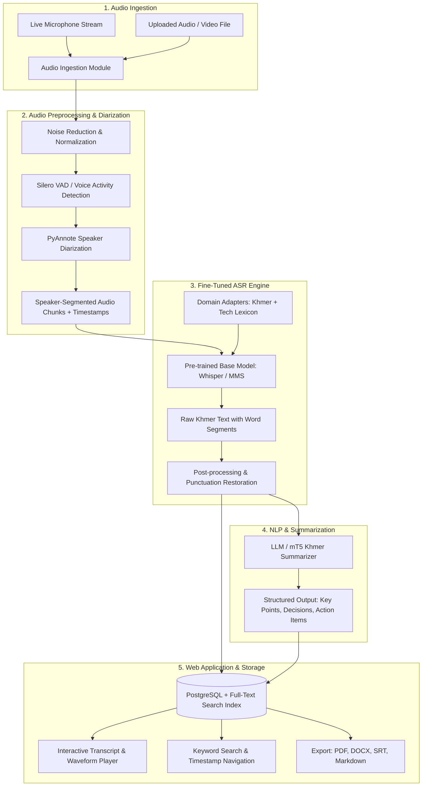
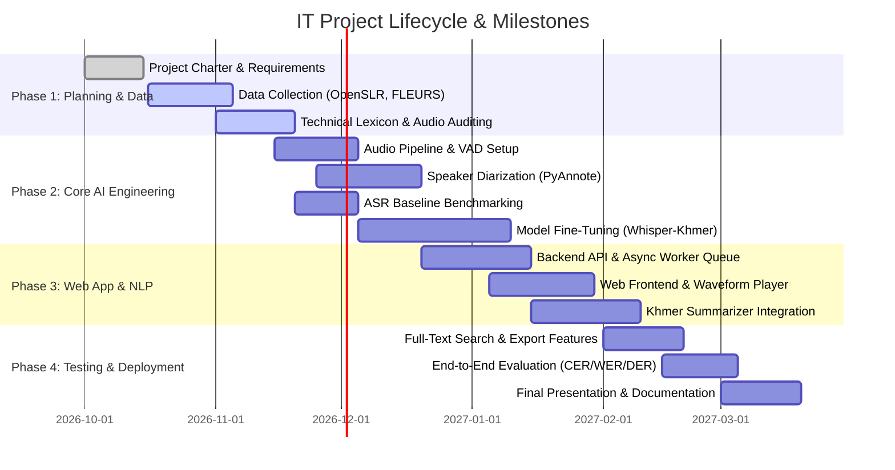

# 🎙️ Khmer Lecture & Meeting Transcriber (KLMT)
### *Intelligent Speech-to-Text, Speaker Diarization & Meeting Summarization for the Khmer Language*

[](#)
[](https://www.python.org/)
[](https://pytorch.org/)
[](https://huggingface.org/)
[](https://fastapi.tiangolo.com/)
[](https://nextjs.org/)
[](#)

---

## 📌 1. Project Overview

In university lectures and corporate meetings across Cambodia, capturing key takeaways and detailed discussions is often manual, time-consuming, and prone to omissions. While speech recognition tools exist for high-resource languages like English and Chinese, **the Khmer language remains underserved by modern Automatic Speech Recognition (ASR)**.

The **Khmer Lecture & Meeting Transcriber** is an end-to-end AI-powered system designed to:
1. **Record or upload** multi-speaker audio from university lectures, workshops, and business meetings.
2. **Perform speaker separation (diarization)** to identify who spoke when.
3. **Generate accurate, time-stamped Khmer transcripts** capable of recognizing mixed Khmer–English technical vocabulary.
4. **Provide instant keyword and semantic search** with synchronized audio playback.
5. **Produce concise, structured summaries** highlighting discussion topics, key decisions, and action items.

---

## ⚡ 2. The Core Technical Challenges ("The Hard Part")

Developing a high-performance speech transcription system for Cambodian academic and professional settings presents unique obstacles:

1. **Low-Resource ASR for Khmer**:
   - Out-of-the-box pre-trained models (e.g., standard OpenAI Whisper, Meta MMS) exhibit high Character Error Rates (CER) and Word Error Rates (WER) on continuous conversational Khmer due to limited representation in general web-scraped training corpora.
2. **Code-Switching & Technical Terminology (Khmer–English)**:
   - STEM lectures and tech meetings frequently blend Khmer syntax with English technical loanwords (e.g., *"Database"*, *"Algorithm"*, *"API"*, *"Pull Request"*, *"Front-end"*). Off-the-shelf models fail when phonetic and phonetic-to-orthographic shifts occur mid-sentence.
3. **Khmer Script Orthography & Word Segmentation**:
   - Khmer does not employ explicit whitespace between words. Accurate post-processing requires Khmer word segmentation (e.g., using `khmer-nltk` or CRF-based segmenters) for meaningful evaluation (WER) and text indexing.
4. **Acoustic Diversity & Multi-Speaker Overlap**:
   - Classroom echo, lecture hall reverberation, air conditioner hum, and overlapping cross-talk require dedicated preprocessing and robust Voice Activity Detection (VAD).

---

## 🏗️ 3. System Architecture & Workflow



---

## ✨ 4. Key Features

- **🎙️ Dual Input Modes**: Real-time meeting recording via browser microphone or file upload (`.mp3`, `.wav`, `.m4a`, `.mp4`).
- **👥 Speaker Diarization**: Automatically labels speakers (e.g., `Speaker 1 (Lecturer)`, `Speaker 2 (Student)`) with exact start and end timestamps.
- **⏱️ Synchronized Interactive Transcript**: Click on any transcribed word or sentence to jump the audio player directly to that exact moment in the recording.
- **🔍 Full-Text Transcript Search**: Quickly locate specific keywords, technical terms, or speaker remarks across long 2-hour recordings.
- **📝 Automated Intelligent Summarization**:
  - **Executive Summary**: High-level overview of the session.
  - **Topic Breakdown**: Chronological or thematic sections.
  - **Action Items & Questions**: Extracted tasks, deadlines, and questions asked during the session.
- **💾 Multi-Format Export**: Export transcripts and notes to PDF, Microsoft Word (`.docx`), Subtitles (`.srt`, `.vtt`), and Markdown (`.md`).

---

## 📊 5. Data Strategy & Datasets

To overcome the low-resource hurdle and technical code-switching, we combine open public datasets with custom domain data:

| Dataset / Source | Estimated Hours | Focus Area | Role in Project |
| :--- | :--- | :--- | :--- |
| **OpenSLR 42 (Khmer Large Speech Corpus)** | ~50+ hours | Native continuous read speech | Base acoustic & linguistic alignment |
| **Google FLEURS (Khmer subset)** | ~12 hours | Multi-speaker read sentences | Multi-accent & acoustic fine-tuning |
| **Mozilla Common Voice (Khmer)** | Community pool | Diverse speakers & accents | Acoustic robustness |
| **Custom Academic & Meeting Corpus** | ~10–20 hours | IT/Tech lectures, discussions & mixed terms | Domain adaptation for code-switching |

### Data Preparation Pipeline:
1. **Audio Standardization**: Resampling to 16kHz mono WAV, loudness normalization (EBU R128).
2. **Text Normalization**: Khmer Unicode normalization, cleaning zero-width spaces (`\u200B`), standardizing punctuation.
3. **Phonetic & Technical Lexicon**: Building a specialized vocabulary mapping for common English loanwords transcribed or spoken phonetically in Khmer.

---

## 🛠️ 6. Technology Stack

### Machine Learning & Audio Processing
- **ASR Foundation**: [OpenAI Whisper](https://github.com/openai/whisper) (Fine-tuned `whisper-small` / `whisper-medium`) or [Meta MMS (Massively Multilingual Speech)](https://huggingface.co/facebook/mms-1b-all)
- **Speaker Diarization**: [PyAnnote Audio](https://github.com/pyannote/pyannote-audio)
- **Voice Activity Detection (VAD)**: [Silero VAD](https://github.com/snakers4/silero-vad)
- **Khmer NLP & Segmentation**: `khmer-nltk`, `sefr-cut` / Khmer word segmenter
- **Summarization**: Fine-tuned `google/mt5-base` / `Qwen` / `Mistral` or Prompt-Engineered LLMs (Gemma / Claude / GPT) with Khmer instructional prompts
- **Evaluation**: `jiwer` (CER/WER computation), `rouge-score`, `pyannote.metrics` (DER)

### Backend & Data Management
- **API Framework**: FastAPI (Asynchronous Python)
- **Task Queue**: Celery + Redis (for asynchronous handling of heavy audio inference jobs)
- **Database**: PostgreSQL (Metadata, users, transcript logs)
- **Search Engine**: PostgreSQL Full-Text Search / SQLite FTS5 / Meilisearch

### Frontend
- **Framework**: Next.js 14 / React with TypeScript
- **Styling**: Tailwind CSS + shadcn/ui
- **Audio Waveform & Playback**: Wavesurfer.js (waveform visualization, audio regions, interactive timestamp jumping)

---

## 👥 7. Team Structure & Work Breakdown

To ensure systematic execution across the IT Project Management lifecycle, responsibilities are divided into 5 core tracks:

```
├── 📁 1. Data Collection & Labelling
├── 📁 2. Model Fine-Tuning (ASR)
├── 📁 3. Audio Pipeline & Speaker Separation
├── 📁 4. Web Application & Search
└── 📁 5. Summarisation & Evaluation
```

| Member / Role | Core Responsibilities | Expected Deliverables |
| :--- | :--- | :--- |
| **1. Data Collection & Labelling** | • Sourcing public datasets (FLEURS, OpenSLR 42)<br>• Recording real IT lecture/meeting audio samples<br>• Auditing and transcribing mixed Khmer–English technical terms<br>• Text normalization & data formatting for Hugging Face datasets | • Curated & balanced training/test datasets<br>• Custom IT domain test benchmark<br>• Annotation guidelines document |
| **2. Model Fine-Tuning** | • Environment setup on GPU (PyTorch/Hugging Face)<br>• Fine-tuning Whisper / Wav2Vec2 on Khmer corpora<br>• Hyperparameter tuning (learning rate, LoRA / PEFT adapters)<br>• Code-switching optimization & model quantization (INT8/FP16) | • Fine-tuned checkpoint repository<br>• Training loss & validation reports<br>• Optimized inference pipeline |
| **3. Audio Pipeline & Diarization** | • Audio ingestion & format conversion (FFmpeg)<br>• Noise filtering & audio normalization<br>• Voice Activity Detection (VAD) chunking<br>• Multi-speaker diarization integration (PyAnnote) | • Robust audio preprocessing script<br>• Speaker timestamp alignment module<br>• End-to-end audio processing pipeline |
| **4. Web Application & Search** | • Next.js UI/UX design (dashboard, audio player, transcript view)<br>• FastAPI backend & async job worker integration<br>• Interactive time-synced audio player (Wavesurfer.js)<br>• Transcript search engine & export utilities (PDF/SRT) | • Fully functional web application<br>• Interactive search & audio playback UI<br>• REST API documentation |
| **5. Summarisation & Evaluation** | • Benchmark model ASR accuracy (CER, WER with Khmer segmentation)<br>• Benchmark Diarization Error Rate (DER)<br>• Develop Khmer lecture/meeting summarization prompts/models<br>• Action item and key discussion topic extraction | • Evaluation benchmark report (CER/WER tables)<br>• Summarization module & prompt templates<br>• User acceptance testing (UAT) results |

---

## 📅 8. Project Roadmap & Milestones



---

## 📈 9. Evaluation Metrics

To scientifically measure the success of the system, the project evaluates each component using industry-standard metrics:

1. **Automatic Speech Recognition (ASR)**:
   - **CER (Character Error Rate)**: Primary metric for Khmer due to lack of spacing ($CER = \frac{S + D + I}{N_{chars}}$).
   - **WER (Word Error Rate)**: Calculated after automated Khmer word segmentation to assess readability.
   - **Code-Switching Accuracy**: Custom accuracy score on targeted English technical keywords.
2. **Speaker Diarization**:
   - **DER (Diarization Error Rate)**: False Alarm + Missed Detection + Speaker Confusion.
3. **Summarization**:
   - **ROUGE-1, ROUGE-2, ROUGE-L**: Comparing generated summaries with human-written lecture/meeting minutes.
   - **Human Qualitative Rubric**: Coverage of key points, clarity, hallucination rate, and action item accuracy.

---

## 🚀 10. Getting Started (Development Setup)

### Prerequisites
- Python 3.10 or higher
- Node.js 18+ & npm/pnpm
- FFmpeg installed (`brew install ffmpeg` on macOS, `sudo apt install ffmpeg` on Ubuntu)
- NVIDIA GPU with CUDA recommended for training and local inference

### 1. Clone the Repository
```bash
git clone https://github.com/CheangSeyha/IT-project.git
cd IT-project
```

### 2. Backend & ML Environment
```bash
# Create and activate virtual environment
python3 -m venv venv
source venv/bin/activate  # On Windows: venv\Scripts\activate

# Install dependencies
pip install -r requirements.txt
```

### 3. Frontend Setup
```bash
cd frontend
npm install
npm run dev
```

---

## 📜 11. Project Management & Governance

- **Methodology**: Agile / Scrum (2-week sprint cycles with sprint reviews and retrospectives).
- **Issue Tracking**: GitHub Issues & Projects (Kanban board).
- **Version Control**: Feature branching (`feat/diarization`, `feat/whisper-finetune`, `feat/frontend-player`) with mandatory pull request reviews.

---

## 📄 12. References & Acknowledgments

- **Google FLEURS Dataset**: [FLEURS Speech Dataset on Hugging Face](https://huggingface.co/datasets/google/fleurs)
- **OpenSLR 42**: [Khmer Large Speech Corpus](https://www.openslr.org/42/)
- **OpenAI Whisper**: Radford et al., *Robust Speech Recognition via Large-Scale Weak Supervision*
- **PyAnnote Audio**: Bredin et al., *pyannote.audio: neural building blocks for speaker diarization*
- **Khmer NLP Tools**: [khmer-nltk](https://github.com/seanghay/khmer-nltk)

---

*This project is conducted as part of the **Year 5 IT Project Management** curriculum.*
