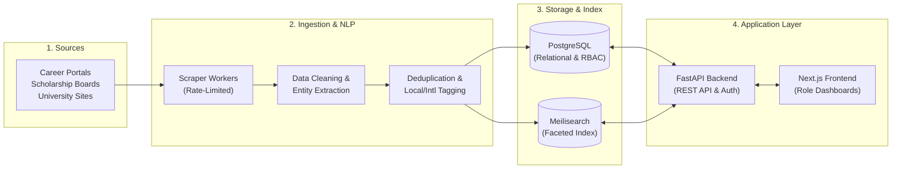

# 🌐 OpportunityHub (OppHub)
> **Centralized Information Retrieval & Opportunity Aggregator for Cambodia & Abroad**  
> Aggregating Jobs, Internships, Upskilling Programs, and Scholarships with automated crawling, intelligent deduplication, and faceted search.

[](https://python.org)
[](https://fastapi.tiangolo.com)
[](https://postgresql.org)
[](https://meilisearch.com)
[](https://nextjs.org)
[](https://tailwindcss.com)

---

## 📖 1. Project Overview

Finding career, training, and scholarship opportunities in Cambodia is currently fragmented across disparate career sites, university portals, social media groups, and institutional boards. 

**OpportunityHub** solves this fragmentation by building a unified data aggregation and retrieval platform:
- **Crawls & Ingests**: Automatically scrapes opportunity listings on a scheduled pipeline.
- **Normalizes & Deduplicates**: Cleans unstructured raw text into a standard schema and merges duplicate postings.
- **Segregates Local vs. International**: Provides dedicated filters tailored to domestic Cambodian requirements vs. overseas opportunities.
- **Faceted Search & Tracking**: Enables sub-second multi-criteria search, application tracking, and personalized alerts.

### Supported Opportunity Types

| Category | Description | Primary Targets |
| :--- | :--- | :--- |
| 💼 **Jobs** | Full-time, part-time, remote, and contract positions | Local companies, NGOs, international employers |
| 🚀 **Internships** | Student placements, paid/unpaid training programs | University partners, entry-level recruiters |
| 📚 **Upskilling** | Technical bootcamps, workshops, certifications | Tech hubs, training academies, MOOCs |
| 🎓 **Scholarships** | Fully/partially funded degree programs and grants | Embassies, international universities, foundations |

---

## ⚡ 2. Core Features & Capabilities

### 🕷️ Automated Data Retrieval
- Scheduled crawler runs across target career portals, university sites, and scholarship boards.
- Robust pagination handling, dynamic page rendering, rate limiting, and exponential retry back-off.
- Multi-source duplicate detection (exact hash matching and fuzzy text similarity).

### 🗺️ Local vs. International Segregation
- **Local (Cambodia) Opportunities**: Filter by province/municipality (Phnom Penh, Siem Reap, etc.), local employment benefits (NSSF, transport, food allowance), and Khmer/English language needs.
- **International Opportunities**: Filter by destination country, funding tier (Fully Funded, Partial, Stipend), visa sponsorship, and language test requirements (IELTS, TOEFL).

### 🔍 Multi-Criteria Filter Engine
- Real-time faceted search powered by **Meilisearch**.
- Granular search criteria: Job title, required skills, field of study, education level, program format (on-site / remote / hybrid), and application deadlines (e.g., closing soon).

### 👤 User Portals & Application Tracking
- **Interactive Tracking**: Kanban pipeline (`Saved` → `Applied` → `Interview` → `Offer` / `Rejected`).
- **Smart Alerts**: Automated email and in-app alerts triggered when newly crawled listings match user profiles.
- **Curated Collections**: Instructors can curate and broadcast specific opportunity bundles to students.

---

## 👥 3. Target User Roles (RBAC)

The platform implements Role-Based Access Control across five distinct user groups:

| Role | Permissions & Core Capabilities |
| :--- | :--- |
| **Public Users** | Search, filter, and view open opportunity listings without an account. |
| **Students** | Bookmark listings, manage personal application pipelines, set match alerts, and configure skill profiles. |
| **Teachers** | Curate and share targeted opportunity lists with students; post academic events and seminars. |
| **Staff / Career Officers** | Post verified institutional opportunities; view student engagement metrics and search analytics. |
| **Admin** | Manage crawler target URLs, schedule spiders, moderate listings, monitor crawler health, and manage user roles. |

---

## 🏛️ 4. Team Member Role Distribution

Project governance and technical responsibilities are divided across 5 core tracks:

| Member & Track | Core Responsibilities | Key Deliverables |
| :--- | :--- | :--- |
| **Member 1**<br>*(Web Crawling & Data Ingestion)* | • Develop automated spiders/crawlers for target sites<br>• Manage pagination, dynamic rendering, and rate limits<br>• Configure scheduled ingestion pipelines | • Production crawler scripts<br>• Automated ingestion schedule<br>• Scraper health & error logs |
| **Member 2**<br>*(Data Cleaning & Entity Extraction)* | • Clean raw text and remove boilerplate HTML<br>• Extract structured entities (deadlines, skills, salary)<br>• Tag Local vs. International and handle deduplication | • Normalization pipeline<br>• Deduplication service<br>• Pydantic validation schemas |
| **Member 3**<br>*(Backend API & Search Architecture)* | • Design PostgreSQL schema and migrations<br>• Build RESTful API endpoints with FastAPI<br>• Configure Meilisearch indexing and RBAC authentication | • Database schema & ORM models<br>• Documented REST API endpoints<br>• Faceted search integration |
| **Member 4**<br>*(Frontend & UI/UX Development)* | • Design responsive UI using Next.js 14 and Tailwind<br>• Implement multi-criteria faceted filter controls<br>• Build role-specific dashboards and tracking boards | • Responsive web application<br>• Faceted search interface<br>• Student & Staff dashboards |
| **Member 5**<br>*(QA, Testing & Project Management)* | • Lead Agile sprints, milestone tracking, and task backlog<br>• Set up CI/CD workflows and automated testing<br>• Conduct legal/ethics checks (`robots.txt`) and UAT | • Sprint reports & project plan<br>• Automated CI/CD pipeline<br>• Ethics audit & UAT reports |

---

## 🏗️ 5. System Architecture



---

## 🛠️ 6. Technology Stack

| Layer | Technologies | Purpose |
| :--- | :--- | :--- |
| **Crawling & NLP** | Python, Scrapy, Playwright, BeautifulSoup4 | Automated data extraction and page parsing |
| **Backend API** | FastAPI, Pydantic, SQLAlchemy, Celery | High-performance asynchronous REST API |
| **Database & Cache** | PostgreSQL 15, Redis | Relational data persistence, sessions, and task queues |
| **Search Engine** | Meilisearch | Fast, typo-tolerant faceted full-text search |
| **Frontend UI** | Next.js 14, React, TypeScript, Tailwind CSS | Responsive, accessible client interface |
| **DevOps & QA** | Docker, GitHub Actions, Pytest, Jest | Containerized deployment and CI/CD testing |

---

## ⚖️ 7. Ethical Crawling & Compliance

To ensure compliance with institutional and legal standards:
- **`robots.txt` Compliance**: All scrapers strictly check and honor source domain crawl directives.
- **Polite Crawling**: Randomized request delays and rate limiting to prevent server stress.
- **Data Privacy**: No Personal Identifiable Information (PII) is scraped or stored.
- **Source Attribution**: Every opportunity listing links directly back to its original publisher.

---

## 🚀 8. Quickstart Guide

### 1. Clone & Configure
```bash
git clone https://github.com/CheangSeyha/IT-project.git
cd IT-project
```

### 2. Launch Supporting Services
```bash
docker run -d --name opphub-db -p 5432:5432 -e POSTGRES_PASSWORD=postgres -e POSTGRES_DB=opportunity_hub postgres:15-alpine
docker run -d --name opphub-search -p 7700:7700 -e MEILI_MASTER_KEY=masterKey123 getmeili/meilisearch:v1.6
```

### 3. Backend Setup
```bash
python3 -m venv venv
source venv/bin/activate
pip install -r requirements.txt
uvicorn app.main:app --reload --port 8000
```
> API Docs: `http://localhost:8000/docs`

### 4. Frontend Setup
```bash
cd Frontend
npm install
npm run dev
```
> Web App: `http://localhost:3000`

---

## 📅 9. Project Milestones

```
Phase 1: Requirements, Source Inventory & Architecture Planning  (Oct - Nov 2026)
Phase 2: Crawlers, Cleaning Pipeline & Meilisearch Indexing      (Nov - Dec 2026)
Phase 3: Backend REST API, RBAC & Next.js Frontend Dashboards   (Dec - Jan 2027)
Phase 4: Tracking Portals, Alert Engine & Integration Testing    (Jan - Feb 2027)
Phase 5: User Acceptance Testing (UAT), CI/CD & Final Release   (Feb - Mar 2027)
```

---

*Conducted as part of the **Year 5 IT Project Management** curriculum.*
